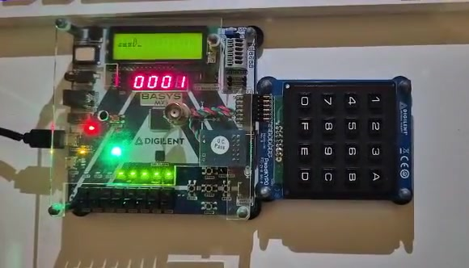
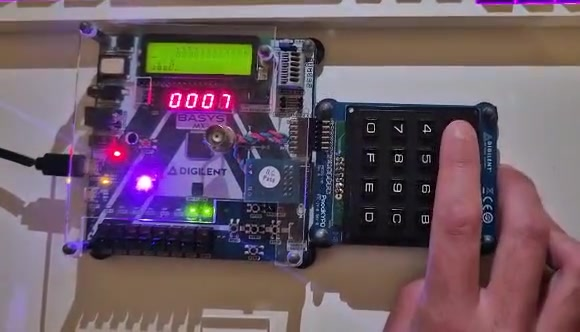
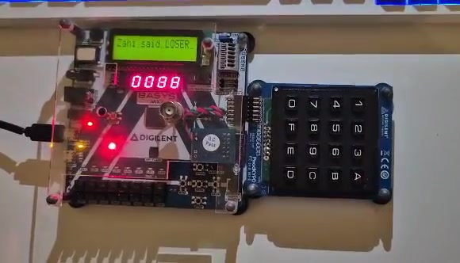

# Caterpillar Game: Bare-Metal C on PIC32

A real-time arcade game written in bare-metal C for the **Digilent Basys MX3** board (**PIC32MX370F512L**).
A caterpillar runs along a 16x2 character LCD, eats apples, collects hearts and dodges butterflies.
The game uses the board's peripherals directly: timers and interrupts, ADC, GPIO, a keypad, LEDs,
a 7-segment display, an RGB LED and a buzzer.


> Final project, embedded systems course, Afeka College of Engineering.

---

## Demo

https://github.com/user-attachments/assets/5641d900-c2b0-4634-bbcf-2b08ad2b547f


| Gameplay | Hearts restore health | Game over |
|:---:|:---:|:---:|
|  |  |  |

---

## How to Play

Objects scroll toward the caterpillar on one of the two LCD rows. Switch rows to catch or avoid them.

| Object | Effect | Feedback |
|---|---|---|
| 🍎 Apple | +1 score on the 7-segment display | Green RGB LED, rising tone |
| ❤️ Heart | +1 health (up to 8) | Pink RGB LED, "potion" tone |
| 🦋 Butterfly | -1 health | Red RGB LED, falling tone |

When health reaches zero, the game ends and a message appears on the LCD.

### Controls

| Input | Action |
|---|---|
| Keypad `1` / `BTNC` | Move to the top row |
| Keypad `2` / `BTND` | Move to the bottom row |
| Keypad `5` / `BTNL` | Pause |
| Keypad `4` / `BTNR` | Resume |
| Keypad `0` / `BTNU` | End the game |
| Potentiometer | Game speed, adjustable live |
| Switches `SW0`–`SW7` | Starting health, 1 to 8 (set before reset; default is 5) |

---

## Hardware Used

| Peripheral | Role in the game |
|---|---|
| 16x2 character LCD | Game screen, with custom CGRAM characters for the caterpillar, apple, heart and butterfly |
| 4x4 keypad (Pmod KYPD) | Player input, scanned by row/column |
| 8 LEDs | Health bar |
| 4-digit 7-segment display | Score (apples eaten) |
| RGB LED | Event feedback, driven with pulse-density modulation |
| Buzzer | Sound effects, square waves generated by a timer interrupt |
| Potentiometer (ADC) | Game speed |
| Slide switches | Starting health |
| Push buttons | Alternative controls |

---

## Firmware Design

The game runs on three timer interrupts, with the main loop handling only the speed control:

```
main loop ──► reads the potentiometer (ADC) ──► reprograms the game-tick timer period

Timer 2/3 ISR (32-bit)  ── game tick: move objects, detect collisions, animate, redraw LCD, update score
Timer 5 ISR             ── scan keypad and buttons, drive the RGB LED (PDM)
Timer 4 ISR             ── toggle the buzzer pin to generate tones
```

Key implementation points:

- **Interrupt-driven architecture.** Three hardware timers with separate priorities, so input sampling, rendering and audio run independently.
- **Variable game speed.** Timers 2 and 3 are chained as one 32-bit timer. The ADC reading (0 to 1023) is mapped linearly to the timer period, and a small threshold filters out ADC noise so the speed only changes on a real knob movement.
- **Custom LCD characters.** Seven 5x8 glyphs are written to the LCD's CGRAM, including two caterpillar body frames that alternate on every tick to animate crawling.
- **Weighted random spawning.** Each round picks an object type with weights (apple 45%, butterfly 40%, heart 15%) and a random row.
- **Software PWM for the RGB LED.** Pulse-density modulation with 8-bit accumulators inside the Timer 5 interrupt.
- **Tone generation.** Each sound effect is a sequence of frequencies and durations. Timer 4 toggles the buzzer pin at the requested frequency for a computed number of half-periods.
- **Direct register access.** GPIO direction (TRIS), analog/digital selection (ANSEL), the ADC (AD1CON) and the timers (TxCON, PRx) are all configured at the register level.

---

## Project Structure

```
CaterpillarGame.X/
├── final_project.c   # Game logic, timers and ISRs, ADC, audio, health and score
├── LCD.c / LCD.h     # Character LCD driver
├── characters.c/.h   # Custom CGRAM glyphs
├── keyboard.c/.h     # 4x4 keypad scanning
├── ssd.c / ssd.h     # 7-segment display driver (Digilent library)
├── rgbled.c / .h     # RGB LED driver (Digilent library)
├── config.h          # Board pin definitions (Digilent library)
├── Makefile
└── nbproject/        # MPLAB X project configuration
docs/
├── demo.mp4
└── screenshots/
```

---

## Building and Flashing

1. Install **MPLAB X IDE** and the **XC32** compiler.
2. Open the `CaterpillarGame.X` folder as a project in MPLAB X.
3. Connect the Basys MX3 over USB, build and program the device.

The target device is `PIC32MX370F512L`, and the project was built with XC32 v4.45.

---

## Credits

The 7-segment, RGB LED and pin configuration files come from the Digilent Basys MX3 library.
